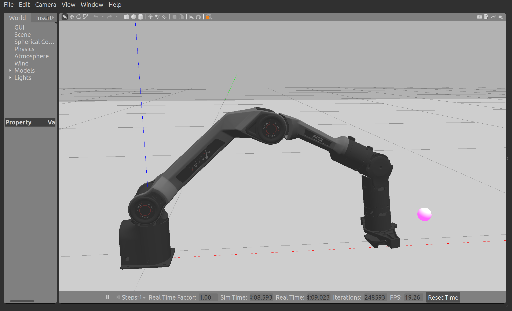

# Piper 实机项目工作区

工作区最初命名为 `ROBOT_PIPERX`，后续可作为任意名称的 Git checkout 使用。**2026-10-13 已通过实机 CAN 查询确认机械臂为 AgileX Piper**。第 4/5 轴上报限位分别为 ±100°、±70°，与官方 Piper 配置一致，而 Piper X 为 ±89°、±89°。本项目与旧实验项目 `ROBOT` 分开；`piperx_lab` 是历史包名，当前控制和标定配置均按 Piper 工作。

## 实机设备型号

| 设备 | 型号 | 项目配置 |
| --- | --- | --- |
| 六轴机械臂 | **AgileX Piper**（不是 Piper X） | `arm_type:=piper`，原厂 `agx_gripper` 夹爪 |
| 腕部三维相机 | **PointSpread OKULO-C1W-H106/940** | 随第六轴转动；手眼外参为 `link6 → camera_depth_frame` |

当前实机标定结果只适用于这套机械臂和相机的安装关系；更换相机或移动支架后需重新标定。

## 当前目录

- `src/agx_arm_ros/`：按 `upstream.repos` 获取的 AgileX 官方 ROS 2 驱动和 MoveIt 包，包含 `agx_arm_urdf` 子模块；本地控制门改动见 `patches/agx_arm_ros_local.patch`。该上游 checkout 不进入本项目 Git 提交。
- `src/piperx_lab/`：本项目自己的 Piper 控制节点（保留原包名以兼容现有命令）。
- `src/vidu_ros2_wrapper/`、`src/vidu_ros2_interfaces/`：从已安装的 Vidu 2.1 SDK 源码复制的官方 ROS 2 相机接口。
- `src/pyAgxArm/`：按 `upstream.repos` 获取的官方 Python SDK；本机旧的 `sdk/` 快照不是 Git 提交内容。

当前实机启动参数为 `arm_type:=piper`，末端是 AgileX 原厂夹爪（`agx_gripper`）。2026-10-13 当前连接的相机为 PointSpread **OKULO-C1W-H106/940**，序列号 `OC1W37X19N`；先前测试过 C1N 相机，但不能将它的内参或手眼外参用于当前设备。项目只从官方 Piper 模型读取限位，不使用旧实验项目的外参或抓取几何常数。

## 当前可运行的基础链路

```bash
# 克隆后在仓库根目录执行；目录名可以是 piper- 或其他名称
vcs import src < upstream.repos
git -C src/agx_arm_ros submodule update --init --recursive
git -C src/agx_arm_ros apply ../../patches/agx_arm_ros_local.patch
source /opt/ros/humble/setup.bash
colcon build --symlink-install

# 终端 A：Piper + 原厂夹爪模型、MoveIt、ros2_control 假硬件；不连接 CAN
bash scripts/start_sim.sh --no-rviz

# 终端 B：查看当前关节角和校验一个小幅目标（弧度）；默认只校验
source /opt/ros/humble/setup.bash
source install/setup.bash
ros2 run piperx_lab joint_move --mode sim
ros2 run piperx_lab joint_move --mode sim --joints 0 0.1 -0.1 0 0 0

# 确认目标后才加 --execute 发送轨迹
ros2 run piperx_lab joint_move --mode sim --joints 0 0.1 -0.1 0 0 0 --execute

# 原厂夹爪总开口宽度以米计；同样先校验，确认后才执行
ros2 run piperx_lab gripper_move --mode sim --width 0.02
ros2 run piperx_lab gripper_move --mode sim --width 0.02 --execute
```

`joint_move` 从官方 Piper URDF 读取关节限位，要求收到新鲜的六关节状态，并将单次最大改变量限制为 0.15 rad。`gripper_move` 从原厂夹爪模型读取 0–0.1 m 宽度范围，单次限制 0.025 m。实机接口使用 `--mode real` 读取 `/feedback/joint_states`；连接并校验后再验证实机运动。官方 Piper URDF 将第 6 轴限制为 ±120°，比实机 CAN 上报的 ±180° 更保守，软件目前按 URDF 的 ±120° 校验。

2026-10-13 早期只读实机测试时，第 1 轴反馈曾约 **155.3°**，超出 Piper URDF 的 ±150° 限位；随后采集的实机标定样本已在不同的关节姿态下完成，不能据此认定原异常已排除。`joint_move --execute` 和实机自动采样脚本都会检查当前姿态是否在 Piper URDF 限位内；再次连接时先核对反馈、零位与现场状态。

## 当前相机

编译 `src/vidu_ros2_wrapper` 之前需在目标机器单独安装 PointSpread Vidu 2.1 SDK，使 CMake 能找到 `Vidu_SDK_Api`；本机的 SDK 安装目录不随 Git 提交。官方 ROS 2 wrapper 源码已复制到本工作区，运行方式：

```bash
# 终端 C：连接当前 Okulo 相机并发布图像、深度和内参
bash scripts/start_camera.sh

# 另一个终端：只读、抓取一组同时间戳的对齐彩色／深度／内参
source /opt/ros/humble/setup.bash
source install/setup.bash
ros2 run piperx_lab camera_target --once

# 持续读取视频流，每秒输出一次所选颜色目标的相机坐标；Ctrl+C 结束
ros2 run piperx_lab camera_target --color red
# 也可选 orange、yellow、green、blue、purple

# 等到检测到目标后保存一帧带中心点和坐标的图片；默认最长等 10 秒
ros2 run piperx_lab camera_target --color red --once --save-frame records/red_target.png
```

先前连接 C1N 相机时实测：原始彩色图 1920×1080，深度和对齐彩色图 640×480，畸变模型为 `brown_conrady`；深度图为 `16UC1`，量程约 **2.4983 m**。这些数值不能直接套用到现在的 C1W；当前 C1W 实机标定样本的对齐图为 640×480，深度内参畸变模型为 `kannala_brandt4`。相机节点从实时 `/camera/info/depth` 和 `/camera/depth_range` 读取当前设备参数。`camera_target` 只读彩色与深度，按指定颜色选取最大连通区域，每秒报告像素位置和相机坐标系下的三维位置，并将有效目标发布到保留的兼容话题 `/piperx/target_camera`。这属于颜色区域定位，尚不能区分同色的不同物体类别；光照变化时需调整 HSV 阈值。先前 C1N 的红色区域检测记录不代表当前 C1W 的新测试结果。当前 C1W 已有实机手眼外参，但目标在基座坐标系下的准确度和实机抓取仍需现场验证。

### 后续使用相机 IMU

Vidu SDK 提供 IMU 读取接口：`GetImuData()` 可读取三轴陀螺仪 `GyroData[3]`、三轴加速度计 `AcceData[3]` 及各自时间戳；当前 C1W 是否输出有效 IMU 数据尚需实测。以后需要相机运动状态时，在 `src/vidu_ros2_wrapper` 中接入 IMU 流，发布 `sensor_msgs/Imu`，并验证时间戳、轴向和单位。当前 wrapper 尚未发布 IMU 话题。陀螺仪角速度不能替代相机到机械臂的手眼标定。

## 腕部上侧相机的手眼标定

用户已确认：相机位于腕部上侧，并且随夹爪绕第六轴一起旋转。相机与 `link6` 保持固定安装关系，因此采用眼在手上标定，以 `link6` 作为相机安装参考系。安装关系示意图见 [docs/camera_mount_link6.png](docs/camera_mount_link6.png)；图中位置仅示意，实际安装偏移和朝向要由手眼标定求出。`calibration/board.png` 和 `calibration/board.json` 是配套的 **200×200 mm、5×5 ArUco** 标定板图案及实际尺寸。没有成品标定板时，打印 [A4 原尺寸版](output/pdf/piperx_aruco_board_A4_200mm.pdf)：选择“实际尺寸 / 100%”，关闭“适合页面”，打印后用尺确认页面上的 100 mm 校验线确实为 100 mm，再将纸平整贴在硬板上。标定过程中将板固定在工作台上，保持不动；校验线尺寸不准或图案被裁切时不要采样。

### Gazebo 手眼标定演示

Gazebo Classic 手眼演示使用官方 Piper + 原厂夹爪模型、工作台上的 ArUco 板，以及固定在 `link6` 上的**不可见模拟相机传感器**。传感器没有可见方块，也没有方块碰撞体。相机安装外参是人为设定的真值，仅用于验证采集与求解流程，不能写入实机的 `calibration/handeye_result.json`。Gazebo 相机是理想彩色相机，不模拟 OKULO 深度噪声或真实镜头畸变。

在工作区根目录的不同终端启动以下进程（每个终端先执行 `source /opt/ros/humble/setup.bash && source install/setup.bash && export ROS_DOMAIN_ID=78`，与当前实机相机的默认 ROS 域隔离）：

```bash
python3 sim/gazebo/make_robot.py /tmp/piper_handeye_gazebo.urdf
export GAZEBO_MODEL_PATH="$PWD/sim/gazebo/models:/usr/share/gazebo-11/models"
export GAZEBO_RESOURCE_PATH="$PWD/sim/gazebo:/usr/share/gazebo-11"
export GAZEBO_MODEL_DATABASE_URI=''
gzserver sim/gazebo/worlds/handeye.world -s libgazebo_ros_init.so -s libgazebo_ros_factory.so
```

```bash
ros2 run robot_state_publisher robot_state_publisher /tmp/piper_handeye_gazebo.urdf --ros-args -p use_sim_time:=true -r /joint_states:=/control/joint_states
```

```bash
python3 sim/gazebo/camera_bridge.py
```

服务启动后，执行一次 `ros2 run gazebo_ros spawn_entity.py -entity piper -file /tmp/piper_handeye_gazebo.urdf`；可另开 `gzclient` 看三维场景。然后运行：

```bash
python3 sim/gazebo/collect_handeye.py
ros2 run piperx_lab handeye_solve --mode sim --samples records/gazebo_piper_handeye/samples --out records/gazebo_piper_handeye/handeye_result.json
```

`records/gazebo_handeye/` 中 2026-10-13 已有的 13 组样本和求解结果来自**旧 Piper X 仿真**，只保留作历史记录；当前求解器会按 `robot` 字段排除它们。新的 Piper 样本单独存放在 `records/gazebo_piper_handeye/`。

新的 Piper Gazebo 演示已重新运行：`records/gazebo_piper_handeye/` 下有 12 组有效样本，平均重投影误差 **0.36 像素**，固定板最大位置散差 **0.8 毫米**、最大角度散差 **0.25°**，`quality_pass=true`。解出的相机外参与仿真设定值相比，平移误差约 **3.5 毫米**、旋转误差约 **0.10°**。标注画面在 `records/gazebo_piper_handeye/board_check_111_622000000.jpg`，矩阵在 `records/gazebo_piper_handeye/handeye_result.json`。这些仍是模拟结果，不能代替实机标定。

### 在 Gazebo 中显示实机相机中心

相机中心展示使用独立的 `camera_center.world`，场景中只有地面和机械臂，没有工作台或虚拟标定板。生成模型时加 `--real-camera-center`，Gazebo 中的**紫色发光球**表示实机 `camera_depth_frame` 原点，它固定在 `link6` 上。加上 `--frozen-sample` 可将实机采集时保存的六关节角固定在模型中，并额外生成一份静态 SDF；这份模型不包含模拟相机传感器。

```bash
python3 sim/gazebo/make_robot.py /tmp/piper_camera_center.urdf \
  --real-camera-center calibration/handeye_result.json \
  --frozen-sample calibration/samples/1791896080_368365465.json

# 另一个终端按上节设置 ROS 与 Gazebo 环境变量后，启动无工作台、无虚拟标定板的场景
gzserver sim/gazebo/worlds/camera_center.world -s libgazebo_ros_init.so -s libgazebo_ros_factory.so

# 再开终端加载静态 SDF；可运行 gzclient 查看三维场景
ros2 run gazebo_ros spawn_entity.py -entity piper_camera_center -file /tmp/piper_camera_center.sdf
ros2 run robot_state_publisher robot_state_publisher /tmp/piper_camera_center.urdf \
  --ros-args -p use_sim_time:=true
```

示例样本保存的六关节角约为 `[3.59, 140.55, -108.98, -4.89, 57.94, 1.98]°`。按该样本保存的 `T_base_wrist` 和实机手眼外参计算，相机中心在 `base_link` 约为 **(0.5917, 0.0107, 0.0684) m**；Gazebo 中查询到紫色球的坐标为 **(0.591657, 0.010675, 0.068351) m**。球体只用于可视化，不代表相机壳体尺寸。固定姿态模型仅用于观察，不能用它执行关节轨迹或仿真手眼采集；手眼演示仍使用独立的 `handeye.world`。已有 Gazebo 进程时需先关闭旧场景并重新启动 `camera_center.world`。



接通 Piper 后，以 `bash scripts/start_real.sh --can can0` 启动驱动，另启 `bash scripts/start_camera.sh`。每将机械臂移到一个能够清楚看到标定板的姿态，待它停止，再从工作区根目录运行一次：

```bash
source /opt/ros/humble/setup.bash
source install/setup.bash
ros2 run piperx_lab handeye_capture --mode real
```

采集节点默认读取同时间戳的 `/camera/color/aligned` 与 `/camera/info/depth`，从 TF 查询 `base_link → link6`，检测 ArUco 板并保存图像、关节角、`T_base_wrist` 和 `T_camera_board`。它只采集，不控制机械臂。**默认用对齐彩色 + 深度内参，是为了让标定结果落在 `camera_depth_frame`——和 `camera_target` 发布三维坐标时用的坐标系完全一致**；此前用原始彩色图（`camera_color_frame`）采的样本属于另一个光学坐标系，不能和视觉目标混用。原始 1920×1080 彩色模式仍保留为 `--camera-source color`，但只用于单独分析，不能喂给后续的基座坐标转换。至少采集 **8 个**有明显姿态变化的样本，然后运行：

```bash
ros2 run piperx_lab handeye_solve
```

### 标定板怎么放

**相机到腕部的距离不需要预先测量——手眼标定求的就是它**（`T_wrist_camera` 的平移向量，模长即距离）。板的位置按下述要点摆放即可：

- 板平放在机械臂正前方的工作台上，板心大致在基座前方 **25–40 cm**、机械臂可达范围的中间，手臂伸过去时相机正对板面。
- 镜头到板面 **30–50 cm**，让板占到画面宽度的 **1/3 到 1/2**（太远标记检测不稳，太近容易出画）。
- 板面尽量正对相机、避免强反光和逆光；全程用胶带或夹具固定，**标定过程中绝对不能移动**，也不能被机械臂碰到。
- 摆好和各姿态之间都用下面的命令确认板在视野里：

```bash
ros2 run piperx_lab board_check --once                        # 检查当前视野里的板
ros2 run piperx_lab board_check --once --save-image records   # 同时存一张标注图
```

它会输出可见标记数、板到相机距离、板占画面的比例和重投影 RMS，并直接给出 `ok` 或需要改进的原因（离太远/太近/标记太少/RMS 偏高）。

**板放对了不一定标定能解出来**：如果手臂只在很小的范围内动，或只绕相机光轴转，平移量在数学上不可观测。请让相机从多个不同角度和距离看板，姿态散度超过 15°（求解器会检查并拒绝不够分散的样本）。

2026-10-13 已从 **12 组 Piper + OKULO-C1W-H106/940 实机样本**求得 `calibration/handeye_result.json`。外参为 `link6 → camera_depth_frame`，平移约 **(-102.96, -18.62, +32.96) mm**；平均标定板重投影 RMS **1.59 px**，固定板最大位置散差 **5.82 mm**、角度散差 **1.30°**，项目质量检查 `quality_pass=true`。逐一剔除一个样本重新求解，外参相对全量解的最大变化为 **2.69 mm / 0.63°**。这些是样本内部一致性指标，并非独立测得的抓取精度。`target_base` 只接受 `robot=piper`、`mode=real` 且质量检查通过的结果，不能误用旧 Piper X 仿真结果；首次用于实机前仍需用已知点核对坐标方向和误差。此前按 `link5` 安装假设写下的说明已作废，不应与 `link6` 样本混用。

实机启动入口是 `scripts/start_real.sh`，必须显式指定 CAN 接口；末端类型默认使用已确认的 `agx_gripper`：

```bash
bash scripts/start_real.sh --can can0
```

该入口默认 `auto_enable:=false`，启用官方驱动的执行期控制门控，并使 MoveIt 跟随 `/feedback/joint_states`。本地驱动配置已让门控同时跟踪手臂和夹爪轨迹。需在确认实机状态后显式使能机械臂；脚本也提供 `--enable` 选项。实机样本证明驱动、关节反馈、TF 和相机采集曾在现场联通；当前会话未重新连接硬件，不能据此判断此刻的 CAN 或相机状态。夹爪门控和完整抓取流程仍未得到现场验证。

`scripts/real_handeye_run.py` 提供相对起始关节姿态的 12 个采样目标，默认只打印预览；只有显式加 `--execute` 才会发送真实轨迹并调用 `handeye_capture`。它使用固定关节偏移，不做碰撞规划，执行前要先检查每个目标在现场是否有足够空间。已有的 12 组实机样本不需要重新运行这个脚本。

实机连接后先用 `ros2 run piperx_lab joint_move --mode real` 只读当前关节状态。确认周围空间、机械臂状态和末端配置后，可通过官方服务 `ros2 service call /enable_agx_arm std_srvs/srv/SetBool '{data: true}'` 使能；随后仍需先运行不带 `--execute` 的目标校验。`--mode real` 与假硬件共用同一个 Piper 限位校验，但不包含碰撞规划；有障碍物的动作应通过 MoveIt 规划后执行。

## 上游版本

源码按 2026-10-10 获取：

- `agx_arm_ros`: `e4ccec1`
- `agx_arm_urdf`: `983788b`
- `pyAgxArm`: `841a625`

## 视觉目标转到机械臂坐标

手眼标定完成后，`target_base` 把 `camera_target` 发布的 `/piperx/target_camera`（`camera_depth_frame`）换算到 `base_link`，并发布 `/piperx/target_base` 与一个 RViz 球标记。它是只读节点：只做坐标换算，不发任何运动命令。

```bash
source /opt/ros/humble/setup.bash
source install/setup.bash
ros2 run piperx_lab target_base --once          # 等一帧并换算；默认读 calibration/handeye_result.json
ros2 run piperx_lab target_base                 # 持续换算
```

该节点会拒绝启动，除非 `calibration/handeye_result.json` 的 `base_frame`/`wrist_frame`/`camera_frame` 分别是 `base_link`/`link6`/`camera_depth_frame`，且 `quality_pass` 为真。收到目标时还会核对 `frame_id`、正深度和时间戳（`--max-target-age` 默认 0.5 s），避免将别的坐标系或旧画面的点当作当前目标。节点先按目标时间戳精确查 TF，超时后回退到“最新”TF，并用 `--max-tf-lag`（默认 0.2 s）挡住明显过期的情况。

抓取用的几何量在 `src/piperx_lab/piperx_lab/grasp_plan.py`：`plan_top_down_grasp()` 把基座坐标下的一个点展开成 pre-grasp → grasp → retreat 三个竖直路点，并给出“工具轴朝下”的姿态四元数；`gripper_width_for_target()` 按目标宽度加余量给出夹爪开口。这两个模块是纯几何函数，不接触 ROS，也已经用单元测试覆盖。

```bash
PYTHONPATH=src/piperx_lab python3 -m pytest src/piperx_lab/test -q
```

## 后续开发约定

项目自有代码放在本目录，依赖官方仓库中的 Piper 模型和驱动；仿真与真机采用相同的机械臂型号参数，但分别验证控制接口、末端执行器和相机标定。
