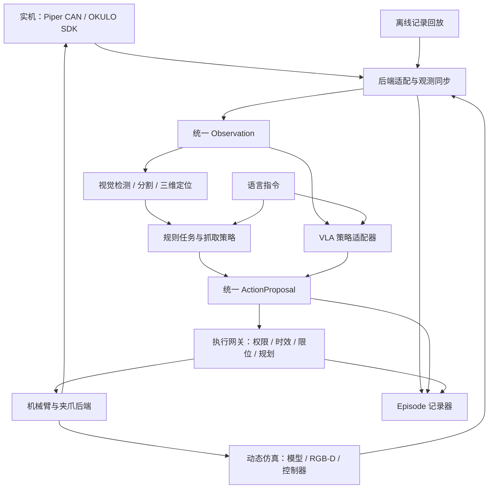

# Piper 视觉、仿真实机统一接口与 VLA 接入规划

日期：2026-10-14。适用设备：AgileX Piper 六轴机械臂、原厂 agx_gripper、随第六轴旋转的 PointSpread OKULO-C1W-H106/940。

本文是待实施的架构方案。以下新增目录、接口和节点均为规划；现有能力与缺口单独列出。项目继续使用 ROS 2 Humble，设备驱动沿用官方接口。

## 1. 建议采用的总体结构

核心设计是让视觉算法、任务逻辑和 VLA 共用观测与动作契约，由后端适配器连接仿真或实机。设备型号、话题名、深度编码和控制协议集中在适配器与配置中。策略只接收观测并提出动作，执行层负责校验、规划、发送和确认结果。



传统视觉路线和 VLA 路线共享执行网关。VLA 可以直接使用图像、语言和机器人状态，不要求先检测出物体；检测模块可另外提供目标选择、可视化、任务结果判断与运行监测。

## 2. 当前项目基础与实际缺口

| 部分 | 已有基础 | 后续工作 |
| --- | --- | --- |
| 机械臂 | 官方模型、CAN 驱动、MoveIt、关节反馈和 TF；joint_move / gripper_move | 建立统一执行接口，验证取消、保持、异常恢复和夹爪反馈 |
| 相机 | Vidu ROS wrapper；彩色、深度、内参 | 统一图像与深度格式、畸变处理、时间同步和设备身份检查 |
| 视觉 | camera_target 用 HSV 定位最大颜色区域 | 支持当前 C1W 内参，再扩展多目标、类别检测、分割与跟踪 |
| 标定 | 12 组实机样本；link6 → camera_depth_frame 外参 | 用独立已知点验证基座坐标误差；维护 TCP 与工具外参 |
| 坐标转换 | target_base 将相机点转换到 base_link | 提供统一、带时间与质量标记的三维目标 |
| 抓取 | grasp_plan 生成预抓取、抓取、撤离路点 | 增加 IK、碰撞规划、动作执行、夹爪时序和成功判断 |
| 仿真 | MoveIt 假硬件；Gazebo 标定演示；静态相机中心展示 | 增加动态操作场景、RGB-D 和可靠的动作反馈 |
| VLA | 尚未接入 | 先建立可回放的任务数据，再接入策略推理与适配 |

当前必须优先解决的具体问题：

- camera_target 的 detect_colored_point() 当前只接受 brown_conrady / plumb_bob，当前 C1W 样本内参为 kannala_brandt4；需按 SDK 对该标识和系数的定义验证相应鱼眼投影/反投影，不能只改白名单后沿用普通 undistortPoints。
- Gazebo camera_bridge.py 当前只转发彩色图和内参，没有深度；现有 handeye.world 可验证标定流程，尚不能证明 RGB-D 识别到接触抓取的完整链路可运行。
- camera_center.world 使用固定姿态模型展示已标定的相机中心，不提供可交互操作环境。
- Gazebo 的 joint_pose_trajectory 插件与当前 MoveIt 动作接口不同，且此前回放后发生姿态漂移；后续操作仿真应验证具有状态反馈的关节轨迹控制链路。
- 12 组手眼样本是标定数据，不能作为连续抓取示范轨迹训练 VLA。

## 3. 模块职责与目录演进

先在现有 piperx_lab 中增量整理模块，保留现有命令兼容入口。等接口稳定后，再把消息定义和启动配置拆成独立 ROS 包，避免一次重写全部代码。

拟新增的仓库结构：

```text
src/
  piperx_lab/
    piperx_lab/
      core/                 # 数据契约、几何、投影、质量检查；不依赖设备驱动
      backends/             # real / fake / gazebo / replay 适配器
      perception/           # 颜色、类别检测、分割、跟踪、三维定位
      policies/             # rule_grasp / imitation / vla 策略适配器
      execution/            # 动作仲裁、校验、规划、执行、结果反馈
      recording/            # 观测、动作与任务 Episode 记录
      ros_nodes/            # ROS 通信包装和现有 CLI 兼容入口
  piper_interfaces/         # 接口稳定后新增：Observation / Detection / Action 等消息
  piper_bringup/            # 后续新增：统一 launch 和配置加载
config/
  backends/                 # real.yaml / fake.yaml / gazebo.yaml / replay.yaml
  cameras/                  # 相机身份、数据格式、标定引用
  robots/                   # 关节顺序、TCP、工具、控制能力
  tasks/                    # 抓取任务、工作空间、验收规则
  policies/                 # 策略输入、输出、预处理与版本配置
sim/gazebo/
  worlds/camera_center.world # 当前清理后的展示场景
  worlds/handeye.world       # 标定演示场景
  worlds/manipulation.world # 待实现：操作评测场景
datasets/                   # 待新增：本地 Episode 数据，默认不进入 Git
```

算法核心用 Python + NumPy/OpenCV；ROS 节点负责通信。VLA 推理独立进程运行，允许独立 Python/模型依赖环境或远端 GPU 服务，避免把 PyTorch 依赖绑定到 ROS Humble 驱动环境。是否需要 C++ 或其他推理引擎，应由测得的延迟与资源占用决定。

## 4. 统一观测：仿真、实机与回放都输出相同语义

Observation 至少包含以下字段；首期可在 Python 数据类中实现，稳定后映射为 ROS 消息与数据集字段。

| 字段 | 约定 |
| --- | --- |
| schema_version / sequence_id | 契约版本和观测编号 |
| source / backend / clock_domain | 实机、仿真或回放来源；明确时间域 |
| timestamps | 各原始传感器时间戳、对齐时间戳与接收时间 |
| images.wrist_rgb | 明确为 RGB，记录尺寸、内参、畸变、图像所属坐标系 |
| depth | 对齐深度，以米表示；无效值用约定掩码或 NaN，不能混用设备原始编码 |
| robot.joint_position / velocity | 官方顺序 joint1…joint6；弧度、弧度每秒；不可用量标为 unavailable |
| robot.gripper_width | 原厂夹爪总开口宽度，米；记录反馈是否真实可用 |
| robot.T_base_wrist / T_base_tcp | 对应观测时间的变换；TCP 必须明确定义 |
| calibration_id / tool_id | 本次相机安装与工具配置的版本标识 |
| health / validity | 图像、深度、反馈、TF 是否有效及其时间偏差 |

相机适配器吸收 Vidu 的 8UC3/BGR 和量程编码差异，供算法使用的深度统一为米。具体转换依据 SDK 对当前设备格式的定义验证，配置中保留原始格式说明。图像缩放、裁剪必须同时更新内参，并在策略预处理与数据集元数据中记录。

仿真 use_sim_time 使用 /clock；实机采用统一的时间基准并验证设备时间与 ROS 时间关系。消息对齐按采集时间，超时和进程看门狗按单调时钟计时，以应对仿真暂停。仿真时钟复位后清空缓存与动作队列。RGB、深度、关节状态和 TF 允许的同步误差应根据实测确定，不能静默拼接任意“最新”数据。

配置负责话题映射和 ROS QoS。大图像只保留有限缓存；远程推理使用有界请求队列，过期观测直接淘汰。一次抓取与一个 VLA 动作都能追溯到其使用的 observation_id。

## 5. 统一视觉：从颜色区域扩展到物体与抓取候选

建议拆成四步：二维检测 → 区域深度估计 → 坐标转换 → 抓取候选生成。

1. 颜色、目标检测或分割插件输出 Detection2D 列表：类别、颜色属性、分数、框或掩码、观测编号。颜色区域应使用 red_region 等标识，避免把“红色”当成已识别物体类别。
2. 三维定位优先使用分割掩码内部有效深度，排除背景、边缘和离群值。输出相机系位置、有效深度比例、估计方法与测量散差；未标定的指标只能称为质量分数，不能当作统计置信度。
3. 使用观测时刻的 T_base_wrist 和对应 calibration_id 的 T_wrist_camera 转到 base_link；坐标系或时效不符时拒绝目标。当前 target_base 的最新 TF 回退可保留为可见的诊断模式，闭环执行需满足明确的同步容差。
4. 任务选择器按语言、类别、区域和跟踪 ID 选择目标。抓取候选独立输出工具姿态、接近方向和开口宽度，并记录估计依据。

深度区域中心通常是可见表面点，不等于物体几何中心或夹爪抓取中心。首个任务可用已知尺寸方块、固定俯视抓取姿态和经过验证的高度补偿；后续再做桌面估计、尺寸测量、姿态估计及多候选抓取。遮挡或多目标时依靠跟踪 ID 保持目标身份。

换用学习式检测或分割时，只替换二维插件。三维计算、外参、动作执行和数据记录继续使用同一接口。暂不固定检测模型，先用当前相机实拍数据验证目标类别、推理延迟和深度定位误差。

## 6. 后端能力：统一接口，但明确验证边界

| 后端 | 用途 | 能证明的能力 |
| --- | --- | --- |
| replay | 读取已录制观测，离线运行视觉或策略 | 输入输出契约、识别与推理回归；不能证明真实动作结果 |
| fake | 现有 MoveIt 假硬件 | 规划调用、动作协议、关节与工具配置；不能证明接触抓取 |
| gazebo | 待完善的动态操作仿真 | RGB-D、运动、接触与任务结果；精度受模型与物理参数影响 |
| real | Piper CAN + OKULO | 实际传感、控制、接触与任务执行 |

后端统一提供 get_observation、execute、cancel、hold、get_status。reset_scene 只由支持它的仿真后端提供；实机任务复位是显式操作流程。每个后端声明 capabilities，例如 has_depth、has_contact_feedback、supports_cartesian_stream，不用虚构数据填补缺失能力。

统一启动配置设 backend=real|fake|gazebo|replay，视觉和策略参数单独配置。实机与仿真采用不同 ROS 域或明确的命名空间；动作所有者必须绑定后端身份。已使能运行时不原地切换后端，切换过程先结束任务、确认执行器状态，再重新加载配置。

动态 Gazebo 需补齐：与 Piper 相同的关节/夹爪模型、可靠的控制器、RGB-D 输出、物体接触与可重复复位。当前实机外参只用于实机；仿真使用其传感器模型对应的外参。若模拟同一安装关系，需同时设置传感器位置与朝向并验证渲染坐标。仿真真值存放在评测通道，部署策略不能意外读取物体真值。

保留 Gazebo Classic 作为当前环境的可用后端；后续若迁移其他模拟器，仅实现同一后端契约，算法层无需围绕模拟器 API 重写。动态场景可逐步加入光照、材质、遮挡、相机与深度噪声变化，评测仍保留固定种子的基准场景。

## 7. 统一动作与执行网关

ActionProposal 包含 action_id、observation_id、task_id、policy_id、backend_id、schema_version、有效期、动作类型、时间范围与动作参数。建议显式支持以下类型：

- joint_trajectory：带时间的六关节目标和独立夹爪目标。
- tcp_pose_goal：指定坐标系中的绝对 TCP 位姿，交给规划器生成轨迹。
- tcp_delta_chunk：若干带时间的 TCP 增量与夹爪目标，用于后续连续策略。
- hold / cancel：明确的任务与动作控制请求。

不能仅凭“7 个数”解释动作。建议项目默认增量契约为 base_link 中的平移增量（米）、旋转向量（弧度）和夹爪总开口目标（米）。旋转用左乘：R_next = Exp(delta_r) × R_current；平移 p_next = p_current + delta_p。与模型原生动作不同的含义由策略适配器转换，转换不具备依据时拒绝接入。绝对位姿使用明确的四元数顺序 xyzw。

link6 是相机安装参考；控制工具点通常是 TCP。必须维护并验证 T_link6_tcp，不能把两者位置直接互换。策略归一化、反归一化参数绑定数据集和检查点版本。

执行网关是唯一发送机械臂与夹爪命令的模块，负责：

1. 仲裁人工示教、规则策略和 VLA 的动作所有权，避免多个发布者同时控制。
2. 检查观测时效、后端身份、数据有效性、关节限位、步长、速度和工作空间。
3. 绝对目标执行 IK 和碰撞规划；增量动作采用经验证的连续控制方法，检查预测路径和夹爪动作。
4. 追踪 received → validated → executing → succeeded/failed/cancelled，关联命令与实际反馈。
5. 失去新鲜观测或策略超时后停止接受新动作，并请求已验证的保持/停止过程。

首期复用 FollowJointTrajectory 与 MoveIt。ROS 2 的 joint_trajectory_controller 提供动作反馈和取消接口；实际 Piper 驱动的取消、停止和保持行为仍需现场验证，服务接受取消不代表机械臂已经停稳。[ROS 2 Humble 控制器官方说明](https://control.ros.org/humble/doc/ros2_controllers/joint_trajectory_controller/doc/userdoc.html)

现有 joint_move 的最短两秒轨迹和小步限制适合点动检查。接入连续 VLA 时需要新的执行适配器与经过测量的控制周期，不能只缩短参数后把多个长轨迹反复覆盖。

## 8. 规则抓取闭环先落地

首个任务建议为“抓取指定颜色的已知方块，放到固定区域”。任务状态依次为观察 → 选择目标 → 生成候选 → 规划接近 → 再观察校正 → 下降 → 合爪 → 抬起 → 检查 → 放置 → 结束。

每个状态具备超时、失败原因和人工接管出口；重新规划次数有上限。执行器报告轨迹完成与任务报告抓取成功分别记录。成功判断结合可用的夹爪反馈、视觉物体跟随、放置区域结果；没有力或电流反馈时如实标注，不凭空推断握持力。

这条链路提供可理解的基准，也产生后续模仿学习和 VLA 所需的观测、动作与任务结果。真实夹爪闭合力度、TCP、碰撞几何与目标高度需要随基准任务验证。

## 9. VLA 接入方式

VLA 作为可替换 Policy 实现 predict(observation, instruction) → ActionProposal。模型推理服务与 ROS 执行网关分开，故障或依赖升级不会直接改变硬件控制进程。

接入一个检查点前先建立 manifest，记录模型及代码版本、相机数量与视角、RGB 预处理、语言格式、是否使用机器人状态、动作类型、坐标系、单位、归一化参数、动作块长度和训练采样周期。当前腕部单相机可先开展任务；若检查点要求外部相机或不同观测，补齐设备或重新训练相应输入，不用空白图像冒充缺失视角。

推理采用有界异步队列，每次请求携带观测与任务版本；迟到、过期、旧任务和旧后端的返回直接丢弃。采用 action chunk 时先执行短前缀，再依据新观测更新，动作交接点校验连续性；具体块长、执行周期与超时由推理延迟分布、控制带宽和任务速度测量确定，不预设某个固定频率能适合所有模型。

推荐验证顺序：

1. 离线回放：检查输入预处理、动作范围、坐标约定和延迟。
2. 动态仿真：完成指定任务并统计失败方式，不能只观察机械臂“动了”。
3. 实机影子模式：读真实观测、预测并显示动作，执行网关禁止发送。
4. 有限任务闭环：经过实测的动作空间和控制参数下执行，记录接管与结果。

模型选型先比较现有 GPU、推理时延、示范数据规模与目标任务，不在此阶段锁定某个 VLA。可先做规则策略基线，再做模仿学习基线，最后评估 VLA 对语言和任务变化的增益。

OpenVLA 官方实现提供新任务/机器人适配训练示例与独立推理服务示例，其示例动作还依赖数据集反归一化参数。这支持本项目采用策略适配器和独立推理进程；预训练检查点能否用于 Piper 仍需专门适配与验证。[OpenVLA 官方仓库](https://github.com/openvla/openvla)

## 10. 从第一条抓取开始记录数据

Episode 记录器订阅统一观测、动作提案、校验结果、发送命令和机器人反馈。首期同时保留 ROS 原始消息记录与版本化任务元数据；再按训练工具需要导出数据格式。

每条 Episode 至少记录：任务文本、开始/结束与终止原因、后端、设备身份、标定/TCP/URDF/配置版本、同步图像与深度、关节与夹爪反馈、实际工具位姿、提议动作、实际发送动作、动作时间、成功标签和人工接管。原始采样时间保留，导出重采样另存配置；示教命令不能用运动后的反馈姿态冒充，避免训练标签与观测错位。

抓取示范可来自后续接入的拖动示教、遥操作或规则策略。相机和关节反馈采集、指令记录、示范动作语义必须在示教工具中同时建立。成功与失败均保留，标签区分视觉判断和人工确认。

本地 datasets 默认从 Git 排除，模型权重和大型数据独立管理。训练/验证/测试按完整 Episode 与采集批次划分，防止同一段视频相邻帧跨集合；实机和仿真来源可追踪，评测单独报告。LeRobotDataset 提供视频及状态/动作等数据的标准组织方式，可作为后续导出目标，采用前固定对应版本和字段映射。[LeRobotDataset 官方文档](https://huggingface.co/docs/lerobot/lerobot-dataset-v3)

## 11. 分阶段实施与验收

| 阶段 | 交付物 | 完成条件 |
| --- | --- | --- |
| P0 基础契约 | 配置、统一观测、相机投影/深度适配、TCP 与外参管理 | C1W 已知点三维误差与时序偏差实测；回放可复现；输入错误可被定位 |
| P1 视觉接口 | 多目标 Detection、深度区域定位、目标选择与跟踪 | 在当前相机实拍数据和回放上评估误检、漏检、定位误差；同色多物体可保持身份 |
| P2 动态仿真与执行 | 操作世界、RGB-D、控制后端、统一执行网关 | 同一任务代码通过 fake 协议检查和动态仿真；验证超时、取消、目标丢失与重置 |
| P3 实机规则抓取 | 抓取状态机、接近/下降/夹爪/撤离、结果判断 | 在限定任务集做重复试验，记录成功率、定位误差、执行异常与人工接管 |
| P4 示范与基线 | 连续 Episode、导出器、模仿学习基线 | 数据质量可审计，动作与观测对齐，保留独立测试集与规则策略对照 |
| P5 VLA | 检查点 manifest、策略适配器、异步推理服务 | 依次通过回放、仿真、影子模式与有限实机任务；与基线比较而非仅展示动作 |

验收数字在每阶段启动时依据实际尺寸、任务容差和测量方法确定。建议报告目标定位误差、任务成功率、推理与动作端到端延迟分布、无效观测率、动作拒绝率和人工接管率；拒绝动作的次数不能单独代表任务安全或成功。

## 12. 下一步建议

先实施 P0：将 camera_target 中的图像解码、深度转换、投影与颜色检测拆成独立模块，建立 Observation 与后端配置，修复并验证 C1W 三维定位，补齐 TCP。随后建立统一执行网关和动态仿真能力，再接抓取状态机。

从现在开始预留连续数据记录与策略契约。这样后续接入 VLA 的主要工作集中在输入预处理、动作适配、训练与推理，已经验证的驱动、标定、坐标转换和执行链路可以继续使用。
